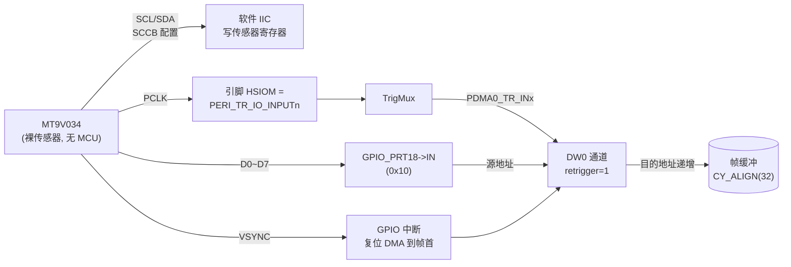
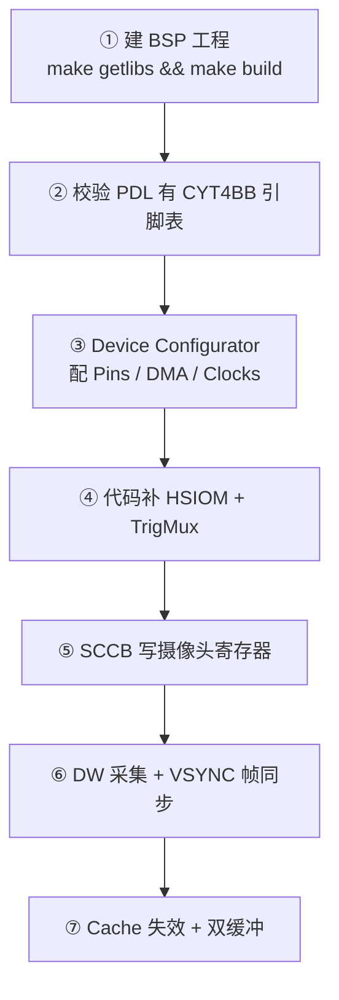
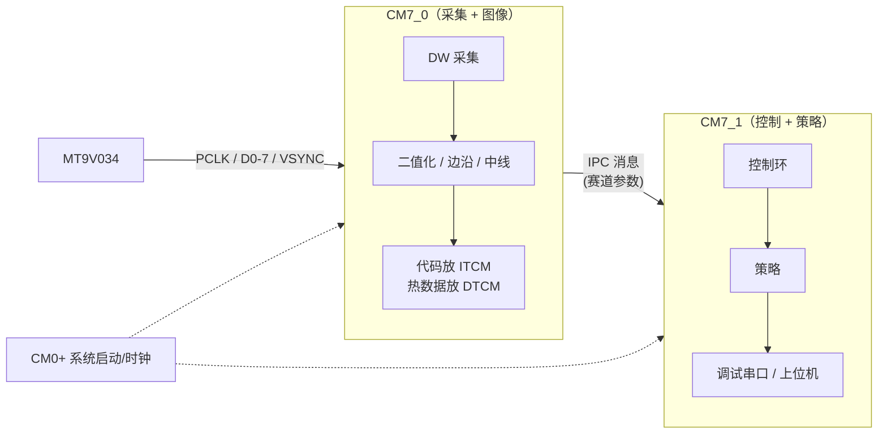

# CYT4BB7 摄像头开发指南（MT9V034 / 总钻风）

> 目标芯片：**TRAVEO™ T2G CYT4BB7**（cat1c，CM0+ + 2×CM7）
> 摄像头：**MT9V034 并口灰度摄像头**（逐飞"总钻风"，无内部 MCU）
> 基线：英飞凌官方 ModusToolbox + PDL（`mtb-pdl-cat1`），不依赖第三方库
>
> 本文所有"已验证"标记的数据，均来自本机实测（PDL 头文件 / 链接脚本 / 器件头）。标注 **⚠需复核** 的条目必须在你的工程里用 Device Configurator 或 datasheet 再确认一次。

---

## 0. 结论速览

| 问题 | 结论 |
|---|---|
| CYT4BB7 有摄像头外设吗？ | **没有**。实测器件头中 `CAMERA / CSI / DVP / JPEG / VIDEO` 关键字计数为 **0** |
| 那怎么接摄像头？ | **GPIO 并口 + PCLK 硬件触发 DW/PDMA + 每次搬 1 字节**，"软 DVP"方案，不需要任何外加器件 |
| 需要 8 位连续端口吗？ | **需要**。144 TEQFP 上可用：`P6.0~P6.7`、`P7.0~P7.7`、`P13.0~P13.7`、`P18.0~P18.7` |
| PCLK 接哪个引脚？ | 必须选带 `PERI_TR_IO_INPUTn` 的引脚，推荐 **P8.1**（`PERI_TR_IO_INPUT14`） |
| 最难踩的坑？ | **D-Cache 一致性**（M7 有 D-Cache，CYT2B 的 M4 没有，迁移时最容易漏） |
| 能用本机现成的 PDL 建工程吗？ | **不能**，见 §1.3 |

---

## 1. 硬件事实（实测）

### 1.1 CYT4BB7 关键参数

| 项目 | 值 | 来源（已验证） |
|---|---|---|
| 器件类别 | **cat1c**（`COMPONENT_CAT1C`） | `mtb-pdl-cat1/devices/COMPONENT_CAT1C/include/cyt4bb7cee.h` |
| 内核 | CM0+（系统）+ **2× CM7** | 同上 |
| 主频 | 250 MHz | 逐飞 `zf_common_clock.h`：`SYSTEM_CLOCK_250M` |
| Flash | **4160 KB**（CM0+ 512K / CM7_0 2048K / CM7_1 1600K） | 逐飞 `linker_directives_tviibh.icf` |
| SRAM | **768 KB**（CM0+ 128K / CM7_0 384K） | 同上 |
| ITCM / DTCM | 有（ITCM `0xA0000000`、DTCM `0xA0010000`） | 同上 |
| **D-Cache** | **有** | 同上 + 逐飞驱动中 `SCB_DisableDCache()` / `SCB_InvalidateDCache_by_Addr()` |
| DW（DataWire/DMA） | **2 个实例**（`DW0` @ `0x40280000`、`DW1` @ `0x40290000`） | `CY_IP_M7CPUSS_DMA_INSTANCES = 2u` |
| AXI DMAC | 1 个实例 | `CY_IP_M7CPUSS_DMAC = 1u` |
| 其他可用外设 | SCB(v2)、TCPWM(v2)、SMARTIO(v3)、EVTGEN、TrigMux、SMIF(v2)、SDHC、I2S(v2)、ETH(v2)、IPC、CAN-FD、LIN | 器件头 IP 包含列表 |

### 1.2 没有摄像头外设（已验证）

对 CYT4BB7 器件头做关键字计数：

```
CAMERA : 0    CSI : 0     DVP : 0     JPEG : 0
GFX : 0       DISPLAY : 0 LCD : 0     VIDEO : 0
PPU : 1785    SMIF : 18   ETH : 9     I2S : 19
```

包含的 IP 头（去重后）：

```
backup_v3, canfd, cpuss, crypto, dmac, dw, efuse, eth_v2, evtgen, fault,
flashc, gpio_v3, hsiom_v3, i2s_v2, ipc, lin, pass, peri_ms_v3,
peri_pclk_v3, peri_v3, prot, scb_v2, sdhc, sflash_v2, smartio_v3,
smif_v2, srss_v3, tcpwm_v2
```

> 结论：TRAVEO T2G 的 Entry(CYT2B) 与 Body-High(CYT3B/CYT4B) 系列都不带图像输入接口。这是产品定位（车身/网关/仪表）决定的，**不是配置问题**。

### 1.3 ⚠ 本机 PDL 版本的坑（已验证，务必先处理）

`mtb-pdl-cat1 v3.25.0` 中 `COMPONENT_CAT1C/include/cyt4bb7cee.h` 的最后几行是：

```c
#include "system_cat1c.h"
#include "xmc7100_config.h"                 /* ← 错误：应为 CYT4BB7 的 config */
#include "gpio_xmc7100_144_teqfp.h"         /* ← 错误：应为 CYT4BB7 的引脚表 */
```

`xmc7100` 是另一颗器件。也就是说 **v3.25.0 对 CYT4BB7 的支持是不完整的**：

- `COMPONENT_CAT1C/include` 下只有 `gpio_tviibh16m_*`、`gpio_tviic2d4m/6m_*`、`gpio_xmc7100/7200_*`，**没有 `gpio_tviibh4m_*`**；
- 因此 `P18_0_PERI_TR_IO_INPUT*` 这类 HSIOM 枚举常量可能不存在，直接用会编译报错。

**做法**：不要手工拼 PDL 版本。用 ModusToolbox → New Application 选一个 CYT4BB7 的 BSP（如 `KIT_T2G-B-H_LITE`），让工具自动解析出匹配的 PDL 版本；建好空工程先 `make getlibs && make build` 跑通，再开始写代码。

验证清单（建完工程立刻查）：

```powershell
# 1. 找到实际使用的 PDL 目录
Get-ChildItem libs\mtb-pdl-cat1 -Directory
# 2. 确认存在 CYT4BB 的引脚表
Get-ChildItem <pdl>\devices\COMPONENT_CAT1C\include -Filter "gpio_*4bb*"
Get-ChildItem <pdl>\devices\COMPONENT_CAT1C\include -Filter "gpio_tviibh4m*"
```

两者至少出现一个，否则换 PDL 版本。

---

## 2. 采集原理（为什么不需要 DVP 控制器）



一句话：**PCLK 每来一个有效边沿 → DW 搬 1 字节（从端口 `IN` 寄存器到 RAM），CPU 全程不参与。**

对比：AURIX TC264/TC377 上逐飞的实现也是同一套路（`dma_init(MT9V03X_DATA_ADD, ..., MT9V03X_PCLK_PIN, EXTI_TRIGGER_RISING, MT9V03X_IMAGE_SIZE)`），**没有任何协处理器/MCU**。

### 2.1 MT9V034 侧关键点

| 项目 | 说明 |
|---|---|
| 供电 | 3.3 V（传感器 I/O 不是 5 V 容忍，别接 5 V） |
| 配置接口 | SCCB（类 IIC），主机写寄存器 |
| 输出 | **10 bit 传感器内部压成 8 bit**，D0~D7 并行输出 |
| PCLK | 传感器自己产生；`PCLK_MODE=0` 时**只在有效像素期间出时钟**（消隐期停） |
| 关键寄存器 | 见 §5.1，地址需按 datasheet 复核 |

> ⚠ **必须保持 `PCLK_MODE = 0`**（不出消隐时钟）。若设成 1，PCLK 会在消隐期连续输出（约 26 MHz 量级），DW 每触发一次搬 1 字节会被打爆，出现 `TransactionRequestLost`/整帧错位。

### 2.2 带宽预算（算清楚再动手）

| 参数 | 值 | 说明 |
|---|---|---|
| 分辨率 | 188 × 120 | 22560 字节/帧 |
| 帧率 | 50 fps | 可 SCCB 配置 |
| **平均带宽** | **≈ 1.13 MB/s** | 22560 × 50 |
| DW 触发频率（`PCLK_MODE=0`） | **≈ 1.13 MHz** | 每字节一次触发 → 250 MHz 主频下毫无压力 |
| DW 触发频率（`PCLK_MODE=1`） | 约 26 MHz | **不要这样配**，除非用 FIFO 突发 |

结论：**字节级触发完全可行**，前提是 `PCLK_MODE=0`。

---

## 3. 引脚规划（先做这一步）

### 3.1 规则

1. **D0~D7 必须在同一个 GPIO 端口的连续 8 个引脚上**（DW 一次读整个端口 `IN` 寄存器）；
2. **PCLK 引脚 HSIOM 必须有 `PERI_TR_IO_INPUTn`**（才能直接触发 DW）；
3. **VSYNC** 普通数字输入 + GPIO 中断即可；
4. SCL 推挽输出、SDA 开漏 + 4.7 kΩ 上拉（软件 IIC 也可两个都开漏）。

### 3.2 144 TEQFP 上满 8 位的端口（已验证）

```
P6.0 ~ P6.7      P7.0 ~ P7.7      P13.0 ~ P13.7      P18.0 ~ P18.7
```

> 逐飞核心板摄像头接口就是接在 **P18** 上，144 脚主板可直插。

### 3.3 PCLK / 触发可用引脚（144 TEQFP，✅ 已验证）

带 `PERI_TR_IO_INPUTn` 的引脚（**已标注调试口冲突**）：

| 引脚 | 144脚号 | 触发输入编号 | 可用性 |
|---|---|---|---|
| P2.0 | 8 | `...IO_INPUT2` | ⛔ **SWJ_TRSTN，勿用** |
| **P2.1** | **9** | `...IO_INPUT3` | ✅ **推荐（VSYNC）** |
| P2.2 | 10 | `...IO_INPUT4` | ✅ |
| P2.3 | 11 | `...IO_INPUT5` | ✅ |
| P2.4 | 12 | `...IO_INPUT6` | ✅ |
| P4.0 | 20 | `...IO_INPUT10` | ✅ |
| P4.1 | 21 | `...IO_INPUT11` | ✅ |
| P6.6 | 33 | `...IO_INPUT8` | ⚠ 若不用于数据总线才可用 |
| P6.7 | 34 | `...IO_INPUT9` | ⚠ 同上 |
| P7.6 | 46 | `...IO_INPUT16` | ⚠ 同上 |
| P7.7 | 47 | `...IO_INPUT17` | ⚠ 同上 |
| **P8.1** | **49** | `...IO_INPUT14` | ✅ **推荐（PCLK）** |
| P8.2 | 50 | `...IO_INPUT15` | ✅ |
| P10.0 | 54 | `...IO_INPUT18` | ✅ |
| P10.1 | 55 | `...IO_INPUT19` | ✅ |
| P12.0 | 66 | `...IO_INPUT20` | ✅ |
| P12.1 | 67 | `...IO_INPUT21` | ✅ |
| P13.6 | 80 | `...IO_INPUT22` | ⚠ 若 P13 作数据总线则被占 |
| P13.7 | 81 | `...IO_INPUT23` | ⚠ 同上 |
| P17.3 | — ⚠需复核 | `...IO_INPUT26` | ✅ |
| P17.4 | — ⚠需复核 | `...IO_INPUT27` | ✅ |
| P19.2 | 112 | `...IO_INPUT28` | ✅ |
| P19.3 | 113 | `...IO_INPUT29` | ✅ |
| **P23.3** | **139** | `...IO_INPUT30` | ✅ 可用 |
| P23.4 | 140 | `...IO_INPUT31` | ⛔ **SWJ_SWO_TDO，绝对不可用** |

> 🔴 **本节修正说明**：早期版本把 **P23.4** 列为 PCLK 候选、把 **P2.0** 列为 VSYNC 推荐，这是**错的**：
> - **P23.4 = SWJ_SWO_TDO**（144 脚 pin 140）
> - **P2.0 = SWJ_TRSTN**（144 脚 pin 8）
>
> 占用调试脚会导致**程序一跑就再也连不上调试器**（详见 [`CYT4BB7_自制板硬件设计指南.md`](./CYT4BB7_自制板硬件设计指南.md) §5）。

### 3.4 推荐接线（本文基准方案）

| 摄像头 | CYT4BB7 | 144脚号 | HSIOM / 用途 |
|---|---|---|---|
| SCL | P17.1 ⚠需复核 | — | GPIO 推挽输出（软件 IIC） |
| SDA | P17.2 ⚠需复核 | — | GPIO 开漏 + 4.7 k 上拉 |
| **D0~D7** | **P18.0 ~ P18.7** | **100~107** | GPIO 输入（High-Z），顺序不能乱，D0→P18.0 |
| **PCLK** | **P8.1** | **49** | `P8_1_PERI_TR_IO_INPUT14` |
| **VSYNC** | **P2.1** | **9** | GPIO 中断（`PERI_TR_IO_INPUT3`，也能做触发） |
| VCC / GND | 3.3 V / GND | — | 共地必须可靠 |

> ⚠ **用 P18 作数据总线的代价**：P18.0~P18.7 同时是 `ADC[2]_0~7`，而 **SAR2 在 144-TEQFP 上就这 8 个通道** ⇒ 接了摄像头后 **SAR2 完全不可用**。若还需要 3 路 ADC，请改用 P13（牺牲 SAR1 的 8 通道）或 P6/P7（牺牲 SAR0）。
> 电机三相电流有**专用引脚** `P11.0/P11.1/P11.2 = ADC[0/1/2]_M`（pin 59/60/61），不受影响。

### 3.5 ⚠ 逐飞主板的一个坑（说明为什么别照抄）

逐飞 CYT4BB 库把 PCLK 定在 **P6.5**，但 P6.5 在 144 脚上**没有** `PERI_TR_IO_INPUT`，只有：

```
P6_5_TCPWM0_LINE2         =  8
P6_5_TCPWM0_TR_ONE_CNT_IN6= 10
```

所以他们的驱动必须绕一层 TCPWM 才能触发 DMA（`mt9v03x_trig_init()`），而且那段代码本身有缺陷（配置 `TCPWM0_GRP0_CNT59`，却 `Cy_Tcpwm_TriggerStart(TCPWM0_GRP0_CNT60)`）。

**自己接线/画板时把 PCLK 放到 §3.3 的引脚上，可以省掉整个 TCPWM 环节。**

---

## 4. 搭建流程（官方库，7 步）



### 步骤 ① 建工程

```
ModusToolbox → New Application → 选 CYT4BB7 BSP（KIT_T2G-B-H_LITE 等）
→ TOOLCHAIN=GCC_ARM, CONFIG=Debug
→ make getlibs
→ make build            # 先保证空工程能过
```

### 步骤 ② 校验 PDL（见 §1.3）

### 步骤 ③ Device Configurator 配置

| 页面 | 配置 |
|---|---|
| **Pins → D0~D7（P18.0~P18.7）** | Digital **Input**、Drive = **High-Z Digital**、**无上下拉**、**不勾 Interrupt** |
| **Pins → PCLK（P8.1）** | Digital Input、High-Z、无上下拉 |
| **Pins → VSYNC（P2.1 / pin 9）** | Digital Input、High-Z、勾 **Interrupt**（Rising 或 Falling，见 §8 ⑤）<br>⛔ **不要用 P2.0（pin 8），它是 SWJ_TRSTN 调试脚** |
| **Pins → SCL** | Digital Output、Strong Drive |
| **Pins → SDA** | Digital In/Out、**Open Drain** |
| **Peripherals → DW0 通道 n** | 见下方"GUI 能做/不能做" |
| **Peripherals → TCPWM** | 本文方案**不需要**（PCLK 直连触发） |
| **Clocks** | 若用 TCPWM 才需要 16-bit 分频器（GUI 值 N → 生成 `N-1U`，这是正常的，不要"修") |

**GUI 能做 / 不能做的边界（重要）**

| 项目 | Device Configurator | 说明 |
|---|---|---|
| 引脚方向/驱动模式/中断 | ✅ 能 | |
| GPIO 输入缓冲使能（`CFG_IN`） | ✅ 能 | 只要 Pin 配成 Digital Input 就会置位 |
| HSIOM 设成 `PERI_TR_IO_INPUTn` | ❌ 通常没有该选项 | **必须写代码** `Cy_GPIO_SetHSIOM()` |
| TrigMux 连接 | ⚠ 取决于 GUI 版本 | 有 TrigMux 页面就配，没有就写 `Cy_TrigMux_Connect()` |
| DW 描述符（源=端口IN、目的递增、1 字节） | ✅ 能 | 触发源编号需与代码一致 |

### 步骤 ④ 代码：HSIOM + TrigMux

```c
/* PCLK: P8.1 -> peri.tr_io_input[14] */
Cy_GPIO_SetHSIOM(GPIO_PRT8, 1u, P8_1_PERI_TR_IO_INPUT14);

/* GPIO 触发输入 -> DW0 通道 3 的触发线
 * 官方 PDL 3.x 的 PERI_ver3/4 只需一次调用（不同于 PERI_ver1 需要两次） */
Cy_TrigMux_Connect(TRIG_IN_MUX_0_HSIOM_IO_INPUT14,   /* 源：GPIO 触发输入 14 */
                   TRIG_OUT_MUX_0_PDMA0_TR_IN3,      /* 目的：DW0 channel3 触发 */
                   false,                            /* 不反相 */
                   TRIGGER_TYPE_EDGE);               /* 边沿触发：每个 PCLK 边沿一次 */
```

> 枚举名 **⚠需复核**：`TRIG_IN_MUX_0_HSIOM_IO_INPUTn` / `TRIG_OUT_MUX_0_PDMA0_TR_INn` 是从同族 `tviibh16m_config.h` 验证到的命名（`TRIG_IN_MUX_0_HSIOM_IO_INPUT14 = 0x44`、`TRIG_OUT_MUX_0_PDMA0_TR_IN0 = 0x40000000`）。CYT4BB7 的编号可能不同，以 Device Configurator 生成的头文件为准。

### 步骤 ⑤ SCCB 配置摄像头

见 §5。

### 步骤 ⑥ DW 采集

见 §6。

### 步骤 ⑦ Cache + 双缓冲

见 §7。

---

## 5. SCCB 配置（写 MT9V034 寄存器）

### 5.1 关键寄存器（⚠地址以 MT9V034 datasheet 复核）

| 寄存器 | 名称 | 用途 |
|---|---|---|
| `0x00` | Chip Version | 读回应为 **`0x1313`**（MT9V034 标识），用于验证 SCCB 通路 |
| `0x01` | Column Start | 窗口起始列 |
| `0x02` | Row Start | 窗口起始行 |
| `0x03` | Window Width | 有效列数（本文 188） |
| `0x04` | Window Height | 有效行数（本文 120） |
| `0x05` | Horizontal Blanking | 水平消隐（影响行时间） |
| `0x06` | Vertical Blanking | 垂直消隐（与 0x05 共同决定帧率） |
| `0x07` | Output Control | 输出/时钟相关控制 |
| `0x35` | Global Gain | 增益，**范围 16~64**，默认 32（此范围与逐飞库 `MT9V03X_GAIN_DEF=32` 且注释"[16-64]"完全吻合） |
| 快门宽度 | Shutter Width（高/低字节） | 曝光时间，越大越亮；地址需复核 |

### 5.2 软件 IIC 骨架

```c
/* 400 kHz 左右；SCL/SDA 都是开漏 + 上拉时最稳 */
static void sccb_delay(void) { /* ~1 µs 空循环，按主频标定 */ }

static void sccb_start(void);
static void sccb_stop(void);
static bool sccb_write_byte(uint8_t b);          /* 返回 ACK */
static uint8_t sccb_read_byte(bool ack);

/** @brief 写 16 位寄存器（MT9V034 是 8 位地址 + 16 位数据） */
static bool sccb_write_reg(uint8_t reg, uint16_t val)
{
    bool ok = sccb_write_byte(0x90u);            /* 8 位从机地址(写)，⚠按 datasheet 复核 */
    ok &= sccb_write_byte(reg);
    ok &= sccb_write_byte((uint8_t)(val >> 8));
    ok &= sccb_write_byte((uint8_t)(val & 0xFFu));
    return ok;
}

/** @brief 读 16 位寄存器（两字节，第二次为重复起始） */
static uint16_t sccb_read_reg(uint8_t reg);
```

### 5.3 初始化顺序

```c
uint8_t cam_init(void)
{
    /* 1) 先验证 SCCB 通路 */
    if (sccb_read_reg(0x00u) != 0x1313u) return 1;   /* 不通 */

    /* 2) 窗口与帧率：顺序有依赖，先行列数再消隐 */
    sccb_write_reg(0x03u, 188u);      /* Window Width  */
    sccb_write_reg(0x04u, 120u);      /* Window Height */
    sccb_write_reg(0x01u, 0u);        /* Column Start  */
    sccb_write_reg(0x02u, 0u);        /* Row Start     */
    sccb_write_reg(0x05u, H_BLANK);   /* 水平消隐：按 datasheet 算，目标帧率 50 fps */
    sccb_write_reg(0x06u, V_BLANK);   /* 垂直消隐：同上 */

    /* 3) 曝光与增益 */
    sccb_write_reg(0x35u, 32u);       /* Global Gain  [16..64] */
    /* 快门宽度：默认 400（越大越亮） */

    /* 4) PCLK 模式：必须是 0（消隐期不出时钟），否则 DW 会被压垮 */
    /* 该项在逐飞库里叫 MT9V03X_PCLK_MODE_DEF，SCCB 版本同样经配置下发 */

    /* 5) 等待 1~2 帧稳定后再开 DW */
    return 0;
}
```

> 从逐飞可读源码里能直接抄到的**确定值**：分辨率 188×120、帧率 50、曝光 400、增益 32（16~64）、`PCLK_MODE = 0`。
> 逐飞的寄存器写入在闭源 `zf_device_config.a` 里（**IAR/ARM 目标，GCC 下链接不过，不要直接用**），所以要自己实现。

---

## 6. DW（DMA）采集实现

### 6.1 描述符配置要点

| 参数 | 值（已验证枚举） | 理由 |
|---|---|---|
| `retrigger` | **`true`** | 允许多次触发复用同一描述符 |
| `triggerInType` | **`CY_DMA_1ELEMENT`** | 一次触发只搬**一个元素**（= 1 字节）。若填 `CY_DMA_X_LOOP`，一次触发会搬完整个 X 循环（= 整帧），那是给"一次触发启动整帧"场景用的 |
| `dataSize` | **`CY_DMA_BYTE`** | 1 字节 |
| `srcTransferSize` | **`CY_DMA_TRANSFER_SIZE_DATA`** | "按 `dataSize` 走"；PDL 只有 `CY_DMA_TRANSFER_SIZE_DATA` 和 `CY_DMA_TRANSFER_SIZE_WORD`，**没有** `..._BYTE` |
| `dstTransferSize` | **`CY_DMA_TRANSFER_SIZE_DATA`** | 同上 |
| `srcAddress` | `(void*)&GPIO_PRT18->IN` | 端口输入寄存器（offset `0x10`），**不递增** |
| `dstAddress` | 帧缓冲 | `CY_ALIGN(32)` |
| `xCount` / `yCount` | `1` / `1` | 每触发一个元素；缓冲的推进由触发次数完成 |
| `descriptorType` | `CY_DMA_SINGLE_TRANSFER` | |

> ⚠ **必须实测确认的一步**：不同 PDL 版本对 `CY_DMA_1ELEMENT` 下"连续触发时 X/Y 计数器是否继续推进、目的地址是否自动递增"的语义一致，但**务必先做最小验证**——只收 1 行（188 字节）后暂停，检查目的地址是否停在第 188 字节处。若停在帧首，说明需要改用 `CY_DMA_X_LOOP` + 每帧重新装载描述符的方案。

```c
/* 官方 PDL 用 Cy_DMA_*（DW_Type*）；逐飞 SDK 里叫 Cy_PDMA_Chnl_*，是同一硬件的不同命名 */
static cy_stc_dma_descriptor_t     desc_frame;
static cy_stc_dma_channel_config_t ch_cfg;   /* 必须文件级 static：PDL 保留指针 */

/* 长度向上取整到 32 字节的倍数，避免 Cache 失效时越界 */
#define IMG_RAW    (MT9V03X_H * MT9V03X_W)                    /* 22560 */
#define IMG_ALIGNED (((IMG_RAW) + 31u) & ~31u)                /* 22592 */

CY_ALIGN(32) static uint8_t frame_buf[2][IMG_ALIGNED];
static volatile uint8_t frame_buf_idx;         /* 当前 DMA 正在写入的缓冲下标 */
static volatile uint8_t frame_ready_idx;       /* 最近一帧已完成的下标 */
static volatile uint8_t frame_ready;           /* 帧就绪标志 */

void cam_dma_init(void)
{
    /* DW 模块级使能（每个 DWx 只需一次） */
    Cy_DMA_Enable(DW0);

    /* 通道配置：enable=false，由 VSYNC 中断里再使能 */
    ch_cfg.enable      = false;
    ch_cfg.bufferable  = false;
    ch_cfg.preemptable = false;
    ch_cfg.priority    = 3u;
    (void)Cy_DMA_Channel_Init(DW0, CAM_DW_CH, &ch_cfg);

    cy_stc_dma_descriptor_config_t d = {
        .retrigger       = true,                        /* 允许反复触发 */
        .triggerInType   = CY_DMA_1ELEMENT,             /* 一次触发搬 1 字节 */
        .triggerOutType  = CY_DMA_1ELEMENT,             /* 未路由，无实际作用 */
        .channelState    = CY_DMA_CHANNEL_ENABLED,
        .dataSize        = CY_DMA_BYTE,
        .srcTransferSize = CY_DMA_TRANSFER_SIZE_DATA,   /* 按 dataSize = 1 字节 */
        .dstTransferSize = CY_DMA_TRANSFER_SIZE_DATA,
        .descriptorType  = CY_DMA_SINGLE_TRANSFER,
        .srcAddress      = (void *)&GPIO_PRT18->IN,     /* 端口 IN，源不递增 */
        .dstAddress      = frame_buf[0],
        .xCount          = 1u,
        .yCount          = 1u,
        .nextDescriptor  = &desc_frame,
    };
    (void)Cy_DMA_Descriptor_Init(&desc_frame, &d);

    /* X 循环：源不递增（关键），目的递增 1 字节 */
    Cy_DMA_Descriptor_SetXloopSrcIncrement(&desc_frame, 0);
    Cy_DMA_Descriptor_SetXloopDstIncrement(&desc_frame, 1);
    Cy_DMA_Descriptor_SetInterruptType(&desc_frame, CY_DMA_DESCR);
}
```

### 6.2 VSYNC 帧同步

```c
/* VSYNC 中断：一帧开始 → 把目的地址拉回帧首并重新使能通道 */
void vsync_isr(void)
{
    Cy_GPIO_ClearInterrupt(VSYNC_PORT, VSYNC_PIN);

    const uint8_t next = frame_buf_idx ^ 1u;           /* 双缓冲切换 */
    Cy_DMA_Channel_Disable(DW0, CAM_DW_CH);
    Cy_DMA_Descriptor_SetDstAddress(&desc_frame, frame_buf[next]);
    Cy_DMA_Channel_SetDescriptor(DW0, CAM_DW_CH, &desc_frame);
    Cy_DMA_Channel_Enable(DW0, CAM_DW_CH);
    frame_buf_idx = next;
}

/* DW 完成中断：整帧收完 → 清 Cache 后交给处理侧 */
void dw_isr(void)
{
    Cy_DMA_Channel_ClearInterrupt(DW0, CAM_DW_CH);

    /* VSYNC 边沿选错时会"半帧就完成"，用计数兜底校验 */
    frame_ready_idx = frame_buf_idx;
    frame_ready = 1u;
}
```

要点：

- 源地址**不递增**、目的**递增**、宽度 **1 byte**；
- **`triggerInType = CY_DMA_1ELEMENT` + `retrigger = true`** 才是"每触发一字节"的关键（写成 `CY_DMA_X_LOOP` 就变成整帧一次搬完）；
- `Cy_DMA_Enable(DW0)` 是模块级使能，初始化时调一次；通道级用 `Cy_DMA_Channel_Enable()`；
- 通道的输入触发线编号 = 通道号（`TRIG_OUT_MUX_0_PDMA0_TR_IN3` → channel 3），TrigMux 必须连到同一个编号；
- **ISR 注册 + `NVIC_EnableIRQ` 必须在 `__enable_irq()` 之前**；
- 所有 `cy_stc_*_context_t` / 描述符 / 通道配置**必须文件级 `static`**（PDL 保留指针，栈上会被覆盖 → HardFault）。

---

## 7. Cache 一致性（M7 必做，最容易漏）

### 7.1 为什么

| 芯片 | D-Cache | 后果 |
|---|---|---|
| CYT2BL3（M4） | **无** | DMA 写 RAM，CPU 直接读到新数据，**不用管** |
| **CYT4BB7（M7）** | **有** | CPU 读的是 Cache 里的旧副本 → **花屏、撕裂、图像"冻住"** |

逐飞 CYT4BB 驱动是整段关 Cache 兜底的：

```c
SCB_DisableICache(); SCB_DisableDCache();   /* 采集期间全关 */
/* ... */
SCB_InvalidateDCache_by_Addr(mt9v03x_image_temp[0], MT9V03X_IMAGE_SIZE);
memcpy(mt9v03x_image[0], mt9v03x_image_temp[0], MT9V03X_IMAGE_SIZE);
SCB_EnableICache(); SCB_EnableDCache();
```

### 7.2 推荐做法（比全关 Cache 好得多）

```c
CY_ALIGN(32) static uint8_t frame_buf[2][MT9V03X_H][MT9V03X_W];  /* 32 字节对齐必做 */

/* 方案 A：读出前失效（简单、可靠） */
SCB_InvalidateDCache_by_Addr((uint32_t *)frame_buf[idx], MT9V03X_IMAGE_SIZE);

/* 方案 B（性能最好）：把帧缓冲配成 non-cacheable 的 MPU 区域，一次配置永久有效 */
/* 用 CMSIS 的 ARM_MPU_SetRegion()；对齐/大小必须满足 MPU 规则 */
```

要点：

- **对齐必须 32 字节**（Cortex-M7 的 Cache line = 32 B），否则 `InvalidateDCache_by_Addr` 会连带失效邻居数据，产生隐蔽 bug；
- `MT9V03X_IMAGE_SIZE = 22560` 不是 32 的整数倍 → **缓冲数组本身要按 32 字节对齐，长度向上取整到 32 的倍数**（如 `22560 → 22592`），避免失效时越界；
- CM0+ **没有 D-Cache**，双核共享帧缓冲时由 M7 一侧负责 clean/invalidate；
- 若 CPU 写过帧缓冲（例如原地滤波），交回 DMA 前要 `SCB_CleanDCache_by_Addr()`。

---

## 8. 双核分工（CYT4BB7 的核心价值）



| 事项 | 建议 |
|---|---|
| 采集与 VSYNC/DW 中断 | 只放 **CM7_0**，避免双核抢同一条 DMA 触发线 |
| 核间通信 | `Cy_IPC_Drv_*` + 共享内存哨兵；传"帧就绪序号"而不是整帧 |
| 帧缓冲位置 | 普通 SRAM（双核都可见），Cyt4BB 的 SRAM 分 SRAM0/SRAM1，注意各核可访问范围 |
| 主频/时钟 | 由 CM0+ 启动镜像配置；`cybsp_init()` 已做生成代码初始化，**别再调 `Cy_PDL_Init()`/`init_cycfg_all()`** |

---

## 9. 调试 Checklist（按顺序打勾）

| # | 检查项 | 方法 / 期望值 |
|---|---|---|
| ① | SCCB 通不通 | 读 `0x00` = **`0x1313`**；读不到先查 SDA 上拉、从机地址、供电 |
| ② | PCLK 有波形 | 示波器测 P8.1；有图时才有脉冲（`PCLK_MODE=0` 消隐期无时钟） |
| ③ | VSYNC 有波形 | 应约 **50 Hz** 脉冲 |
| ④ | DW 在动 | 调试器看目的地址递增；先测"只收 1 行 188 字节" |
| ⑤ | 帧对齐 | 缓冲首字节应为行首；整体平移 → VSYNC 边沿极性反了，改 Rising/Falling |
| ⑥ | 无撕裂/花屏 | 先查 **Cache 失效**，再查双缓冲和 32 字节对齐 |
| ⑦ | 帧率达标 | 计数 `frame_ready` 每秒次数 ≈ 50 |
| ⑧ | 无错位/斜纹 | 查 DW `TransactionRequestLost`；确认 `PCLK_MODE=0`；降分辨率或加 FIFO |
| ⑨ | 长时间稳定 | 连续跑 10 分钟不丢帧、不 HardFault |

### 故障速查表

| 现象 | 最可能原因 |
|---|---|
| 图像全 0 / 全 255 | SCCB 没写进去（ID 读不到）；或 `PCLK_MODE=1`；或 GPIO 输入缓冲未开 |
| 图像整体偏暗一半 | 数据只接了 D1~D7 却没左移 1 位（丢 LSB 方案必须 `(in & 0x7F) << 1`） |
| 图像斜着滚动 | VSYNC 中断没生效 / 目的地址没在帧首复位 |
| 图像周期性撕裂 | 单缓冲；或 Cache 未失效 |
| 图像"冻住"不动 | **典型的 Cache 问题**（读到旧副本） |
| 偶发整帧丢失 | DW 触发丢失（`TransactionRequestLost`）；提高通道优先级 / 降 PCLK 占空 |
| 一跑就 HardFault | `cy_stc_*` 上下文是栈变量；或 ISR 在 `__enable_irq()` 后才注册 |
| 编译报 `P18_0_...` 未定义 | PDL 版本不含 CYT4BB 引脚表（§1.3） |
| 改了引脚没效果 | 只改了宏，忘改 HSIOM 和 TrigMux 的触发编号（两处必须一致） |

---

## 10. 从 CYT2BL3 迁移到 CYT4BB7 的差异清单

| 项目 | 改动量 | 说明 |
|---|---|---|
| 采集 / 配置 / 图像算法逻辑 | ✅ 几乎不变 | PDL API 同名（`Cy_GPIO_*`/`Cy_DMA_*`/`Cy_TrigMux_*`/`Cy_SysClk_*`） |
| 引脚宏 | 改 | 如 `P18_0` 系列 |
| HSIOM + TrigMux 编号 | 改 | 两处必须同步 |
| 时钟树 / TCPWM 实例号 | 改 | |
| **Cache 失效** | **新增（必须）** | M4 无 Cache → M7 有，漏了就是花屏 |
| 缓冲对齐 | **新增 32 字节对齐** | `CY_ALIGN(32)` |
| 工程骨架 | 新建 | cat1c BSP，自动拉匹配 PDL |
| 双核 IPC 分工 | 新增（推荐） | 单核也能跑，但没发挥 M7×2 |
| 显存/帧率 | 可放大 | 768 KB SRAM：188×120 双缓冲仅 45 KB，可上 752×480 级或做多帧 |

---

## 11. 附录：丢 1 LSB 方案（端口不够 8 位时）

适用于 64 脚等没有连续 8 位端口的封装（如你现有的 CYT2BL3CAS）。

| 项目 | 8 位全接 | 丢 1 LSB |
|---|---|---|
| 量化级数 | 256 | 128 |
| 量化步长 | 1 | 2 |
| SQNR | 基准 | −6.02 dB |
| 直方图 bins | 256 | 128 |
| Sobel 梯度幅值 | 基准 | 约减半 → **阈值需同步调小** |

要点：

- MT9V034 是 10 bit 传感器压成 8 bit，**最低位主要是 ADC 噪声/dither**，丢它损失远小于理论值；
- 二值化、大津法、边线跳变检测**几乎无感**；灰度加权质心/亚像素定位**有可见影响**；
- 必须左移还原：`gray8 = (GPIO_PRTx->IN & 0x7F) << 1`；
- ⚠ **D0 只能悬空，绝不能短接 GND**（CMOS 推挽输出对地短路会长期大电流）。

CYT4BB7（144 TEQFP）有 4 个满 8 位端口，**不需要用这个折中方案**。

---

## 12. 参考文件（本机路径）

| 内容 | 路径 |
|---|---|
| CYT4BB7 器件头（cat1c） | `mtb_shared/mtb-pdl-cat1/release-v3.25.0/devices/COMPONENT_CAT1C/include/cyt4bb7cee.h` |
| 144 脚引脚/HSIOM 表（逐飞 SDK） | `Seekfree_CYT4BB_Opensource_Library/libraries/sdk/tviibh4m/hdr/gpio_cyt4bb_144_teqfp.h` |
| TrigMux 枚举命名参考（同族） | `.../COMPONENT_CAT1C/include/tviibh16m_config.h` |
| DW DMA 驱动（官方 PDL） | `mtb-pdl-cat1/release-v3.25.0/drivers/include/cy_dma.h` |
| TrigMux 驱动（官方 PDL） | `mtb-pdl-cat1/release-v3.25.0/drivers/include/cy_trigmux.h` |
| 逐飞摄像头驱动（可读部分） | `Seekfree_CYT4BB_Opensource_Library/libraries/zf_device/zf_device_mt9v03x.c` |
| 逐飞完整采集实现参考（AURIX） | `Example/E04_TC377/.../zf_device_mt9v03x.c`（22 KB，含 DMA 链表） |
| 内存布局 | `Seekfree_CYT4BB_Opensource_Library/project/iar/icf/linker_directives_tviibh.icf` |
| 本机 CYT2BL3 工程文档 | `docs/工程配置流程.md`、`docs/编译烧录排障手册.md` |

---

## 13. 待复核清单（动手前务必确认）

| 条目 | 怎么确认 |
|---|---|
| PDL 版本是否含 CYT4BB7 引脚表 | §1.3 的两个 `Get-ChildItem` |
| `TRIG_IN_MUX_0_HSIOM_IO_INPUTn` / `TRIG_OUT_MUX_0_PDMA0_TR_INn` 的准确枚举名 | Device Configurator 生成头文件，或器件 `*_config.h` |
| MT9V034 寄存器地址（0x01~0x07、0x35、快门宽度） | MT9V034 datasheet |
| SCCB 从机地址（0x90 写 / 0x91 读） | 模块 datasheet |
| PCLK 实际频率与极性 | 示波器实测 |
| 你的 BSP 里 `GPIO_PRT18` 与 `DW0` 可用性 | Device Configurator + 编译验证 |
