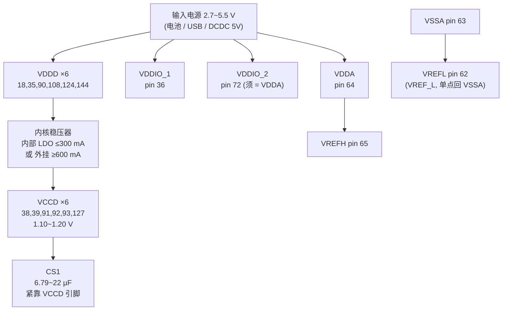
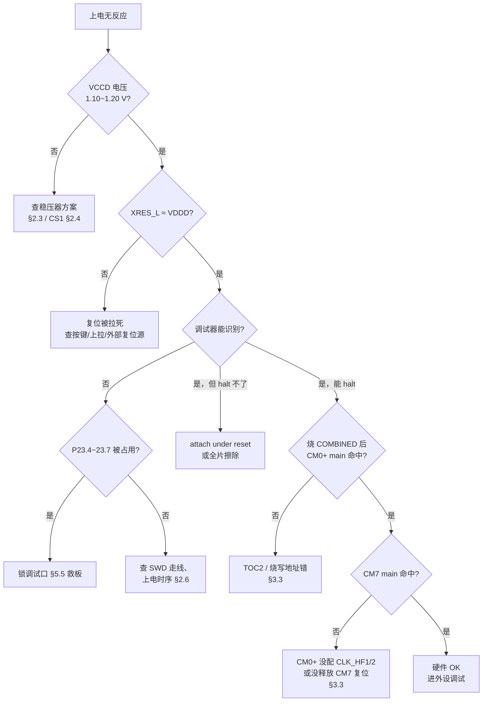

# CYT4BB7 自制板 / 核心板硬件设计指南

> 目标：**让自制的 CYT4BB7 板子能上电、能启动、能烧写、能调试**
> 次要：外设（TCPWM 电机、ADC、摄像头）使用要点
>
> 器件：**TRAVEO™ T2G CYT4BB7**（cat1c：CM0+ + 2×CM7），本文数据以 **144-TEQFP** 封装为准
> 依据：`Infineon-TRAVEO_T2G_CYT3BB_4BB-DataSheet-v10_00-EN.pdf`（Rev. \*I, 2023-07-12）第 8/9/26 章 + 逐飞 SDK 器件头/引脚头
>
> **标记约定**
> - ✅ **已验证**：直接从 datasheet 表格或 SDK 头文件读出
> - ⚠ **需复核**：受限于 PDF 文本提取，或依赖你的具体型号/生命周期状态
> - 💡 **工程经验**：datasheet 没明说，但按规范推导

---

## 0. 十条最容易让板子起不来的地方（先看这个）

| # | 坑 | 后果 | 章节 |
|---|---|---|---|
| 1 | **VCCD 没接对外挂稳压器**（满载双 M7 需 ≥600 mA） | 上电就复位/跑飞 | §2.3 |
| 2 | **CS1 平滑电容缺失或容值不对**（必须 6.79~22 µF） | 内部 LDO 振荡、复位循环 | §2.4 |
| 3 | **VCCD 六个引脚没并联** | 内核供电阻抗高 | §2.4 |
| 4 | **断电时间 < 100 µs 就重新上电** | 起不来（tPOFF 未满足） | §2.6 |
| 5 | **只烧 CM7 镜像，没烧 CM0+ 镜像** | 片子上电毫无反应 | §3.3 |
| 6 | **P23.4~P23.7 被当普通 GPIO 用了** | 调试器永远连不上 | §5 |
| 7 | **晶振买了泛音（overtone）型** | 不起振 | §4.1 |
| 8 | **用 P18.0~P18.7 又同时想用 ADC[2]** | SAR2 完全不可用 | §9.1 |
| 9 | **VDDA 与 VDDIO_2 给了不同电压** | ADC/IO 异常 | §2.5 |
| 10 | **散热焊盘没接 VSSD** | 焊接不良 + 散热不足 + 地回流差 | §6 |

---

## 1. 144-TEQFP 引脚底座（✅ 已验证，datasheet Table：Power supply pin assignments）

这张表是自制板能否工作的地基，**逐脚核对，不要凭经验**。

### 1.1 电源与地

| 引脚名 | **144-TEQFP 引脚号** | 数量 | 作用 |
|---|---|---|---|
| **VDDD** | **18, 35, 90, 108, 124, 144** | 6 | 主数字电源 |
| **VSSD** | **1, 19, 37, 73, 94, 109, 125, 126** | 8 | 主数字地 |
| **VCCD** | **38, 39, 91, 92, 93, 127** | 6 | 内核稳压输出（内部 LDO 或外挂） |
| **VDDIO_1** | **36** | 1 | I/O 电源（除 VDDA 上的模拟 IO） |
| **VDDIO_2** | **72** | 1 | I/O 电源（**必须与 VDDA 同电压**） |
| **VDDIO_3** | **不存在（NA）** | 0 | 144 脚无此电源域 |
| **VDDA** | **64** | 1 | SAR ADC 模拟电源 |
| **VSSA** | **63** | 1 | 模拟地 |
| **VREFH** | **65** | 1 | ADC 高基准 |
| **VREFL** | **62** | 1 | ADC 低基准 |
| **XRES_L** | **123** | 1 | 外部复位（低有效） |
| **DRV_VOUT** | **130** | 1 | 外挂 NPN 基极驱动输出 |

> ⚠ **VDDIO_3 在 100/144/176-TEQFP 上都不存在**，只有 272-BGA 有（P24/P25 的 HSIO 供电）。
> 你在网上看到的"VDDIO_3 只有 2.7~3.6 V"是 272-BGA 的约束，**144 脚不用管**，但也不要以为它有 5 V 的独立 IO 域。

### 1.2 时钟 / 复位 / 稳压器控制 / 调试

| 功能 | 端口.引脚 | **144-TEQFP 引脚号** | 备注 |
|---|---|---|---|
| **ECO_IN** | P21.2 | **121** | 主晶振输入 |
| **ECO_OUT** | P21.3 | **122** | 主晶振输出 |
| **WCO_IN** | P21.0 | **119** | 32.768 kHz 晶振输入 |
| **WCO_OUT** | P21.1 | **120** | 32.768 kHz 晶振输出 |
| **EXT_CLK** | P21.2 | 121 | 外部时钟输入（与 ECO_IN 复用） |
| **EXT_PS_CTL0** | P22.1 | **131** | NPN 模式：采样电阻**正端**<br>PMIC 模式：**Power Good 输入**（PMIC→MCU） |
| **EXT_PS_CTL1** | P22.2 | **132** | NPN 模式：采样电阻**负端**<br>PMIC 模式：**Enable 输出**（MCU→PMIC） |
| **EXT_PS_CTL2** | P22.3 | **133** | NPN 模式：不用<br>PMIC 模式：部分 PMIC 的复位阈值调整 |
| **DRV_VOUT** | — | **130** | NPN 模式：基极驱动（≤9 mA） |
| **XRES_L** | — | **123** | 复位 |
| **SWJ_TRSTN** | P2.0 | **8** | JTAG TRST（SWD 时一般不用） |
| **SWJ_SWO_TDO** | P23.4 | **140** | **调试口，不可占用** |
| **SWJ_SWCLK_TCLK** | P23.5 | **141** | **调试口，不可占用** |
| **SWJ_SWDIO_TMS** | P23.6 | **142** | **调试口，不可占用** |
| **SWJ_SWDOE_TDI** | P23.7 | **143** | **调试口，不可占用** |

### 1.3 散热焊盘

> ✅ datasheet 原文：**"For all TEQFP packages, the thermal pad needs to be connected to VSSD."**

散热焊盘（exposed pad）**必须接 VSSD**，并且💡建议：
- 焊盘下方打 **9~16 个过孔**到内部地平面（孔径 0.3 mm、间距 1.0~1.2 mm）
- 不要用"焊盘只靠引脚地回流"的省事做法

---

## 2. 电源设计（最决定生死的一章）

### 2.1 电源域总览



### 2.2 电压范围（✅ Table 26-2 Recommended operating conditions）

| 电源 | Min | Typ | Max | 备注 |
|---|---|---|---|---|
| VDDD / VDDA / VDDIO_1 / VDDIO_2 | **2.7 V** | — | **5.5 V** | 见下方 BOD/OVD 说明 |
| VDDIO_3（仅 BGA） | 2.7 V | — | 3.6 V | 144 脚无 |
| **VCCD（外部供电时）** | **1.10 V** | **1.15 V** | **1.20 V** | 窄窗口，尽量用 1.15 V |
| VDDIO_1_EFP（eFuse 烧写） | 3 V | — | 5.5 V | 仅烧 eFuse 时需要 |

**BOD / OVD 可选档位**（✅ Note 56/57）：

| 档位 | 效果 |
|---|---|
| BOD 2.7 V（默认） | 低于 2.7 V 触发复位 |
| BOD 3.0 V | 保证 3.0 V ±10% 全工况，但**低于规格电压就会复位** |
| OVD 5.0 V | 保证到 5.0 V |
| OVD 5.5 V | 允许到 5.5 V，但**超过 5.0 V 累计不得超过 2 小时**，且此时电气参数不保证 |

> 💡 实际含义：**VDDD 长期跑 5.5 V 是"允许但不推荐"**。跑 5 V 系统请把 OVD 设到 5.0 V 档，跑 3.3 V 系统把 BOD 设到 2.7 V 档（默认）即可。

### 2.3 ⭐ VCCD 内核电源：三种方案，必须选一种

CYT4BB7 内部有**三个稳压器**（✅ §3.2.2）：

| 稳压器 | 能力 | 何时工作 |
|---|---|---|
| DeepSleep | 小 | DeepSleep 模式（保 ILO/WDT/BOD/SCB0/SRAM/SmartIO） |
| **Core internal** | **≤ 300 mA**（SID604 IILDOUT） | **启动阶段 + Active/Sleep 轻载** |
| **Core external** | **≥ 600 mA**（SID605 IHCROUT） | **满载：双 M7 @250 MHz + 全部外设** |

> ✅ datasheet 原文：
> "To support worst-case loading, with both M7 CPUs and the M0+ CPU at their maximum clock frequency and all integrated peripherals operating, **a core external regulator is required, capable of load currents up to 600 mA**. While the control and monitor circuits for the core external regulator are internal to CYT3BB/4BB, the power regulating element (NPN pass transistor, PMIC, or LDO) **is external**."

**怎么判断你需要哪种？**

| 你的用法 | 方案 |
|---|---|
| 只是点亮、跑跑串口、单核低频 | 可能只靠内部 LDO 就行（≤300 mA）💡但仍建议按下面做 |
| **双 M7 250 MHz + 摄像头/电机/以太网** | **必须外挂，否则不稳** |

#### 方案 A：外挂 NPN 射随晶体管（✅ Figure 3-1）

```
VDDD ──┬── NPN 集电极 (如 ZXT849K)
       │        │ 发射极 ──► VCCD（6 脚并联）
       │        │            └── CS1 (6.79~22 µF) ── VSSD
       │     DRV_VOUT (pin 130) ── 基极
       │
    EXT_PS_CTL0 (P22.1/pin131) ──[0.1 Ω, 1%, 1/4 W]── EXT_PS_CTL1 (P22.2/pin132)
                                    ↑ 电流采样电阻
    EXT_PS_CTL2 (P22.3/pin133) ── 不用
```

| 要点 | 说明 |
|---|---|
| 采样电阻 | **0.1 Ω / 1% / 1/4 W**（datasheet 图注） |
| 基极电流上限 | **≤ 9 mA**（SID608 IDRV_OUT）→ 据此选 NPN 的 hFE |
| 布局 | 采样电阻与 CTL0/CTL1 走**差分、短、等长**，远离 PWM 与开关电源节点 💡 |
| 散热 | NPN 承担 (VDDD − 1.15 V) × I 的功耗，5 V 输入 + 600 mA 时约 **2.3 W**，必须散热 💡 |

#### 方案 B：外挂 PMIC / LDO（✅ Figure 3-2）

```
VDDD ──► PMIC / LDO 的 Vin
EXT_PS_CTL1 (P22.2/pin132) ──► PMIC 的 EN（高有效；无内部下拉时必须外加下拉）
EXT_PS_CTL0 (P22.1/pin131) ◄── PMIC 的 PG（Power Good，高有效）
PMIC 的 FB/VOUT ──► VCCD（6 脚并联）── CS1 ── VSSD
```

| 要点 | 说明 |
|---|---|
| 🔴 **PMIC EN 必须在上电期间保持关闭** | ✅ 原文："If EN pin of PMIC does not have the internal pull-down resistor, **an external pull-down resistor must be placed to keep the PMIC disabled during power-on reset**" |
| 输出电压设定 | 按所选 PMIC 配 R1/R2，目标 **1.15 V** |
| 时序 | 必须晚于 VDDD 建立，且 POR 期间关闭 |
| ⚠ **Hibernate 模式注意** | ✅ 原文："When CYT3BB/4BB is in Hibernate mode, the GPIO used to control the core external regulator are **High-Z**. This may require an external pull-up or pull-down resistor to disable the external regulator" |
| EXT_PS_CTL0/1 电气 | VOL ≤ 0.5 V @1 mA；VOH ≥ 0.5 V；VIH ≥ 0.7×VDDD；VIL ≤ 0.3×VDDD（✅ SID606~607B） |

> 💡 **PMIC 的 EN 下拉电阻不要省**，这是"板子偶尔起不来、反复上电有时行有时不行"的头号原因之一。

#### 方案 C：用内部 LDO 直出（仅小负载）

VCCD 引脚只接 CS1 到地，不外挂任何器件。**只在轻载时可靠**。⚠ 做到成品前必须实测满载 VCCD 纹波。

### 2.4 ⭐ CS1 平滑电容（✅ SID41）

| 参数 | 值 |
|---|---|
| **容量** | **6.79 µF ~ 22 µF** |
| 数量 | **每芯片一个**（不是每个 VCCD 引脚一个） |
| 位置 | **尽可能靠近 VCCD 引脚** |
| VCCD 引脚 | **6 个必须全部并联在一起**（✅ Note 28/59：低阻抗连接） |

> ✅ 原文："Smoothing capacitor, CS1 is required per chip (not per VCCD pin). The VCCD pins must be connected together to ensure a low-impedance connection."

💡 工程建议（DC-bias 效应，✅ Note 60 提到需注意）：
- 选 **X7R/X5R、16 V 或 25 V 耐压、1210 或 1206 封装**的 10 µF，DC-bias 下仍能有 6~8 µF
- 不要用 0402 的 10 µF（5 V 偏置下掉到 2 µF，直接不合格）
- 可再并 1 个 100 nF 高频旁路
- 上电浪涌 **IRUSH ≤ 850 mA**（SID603，给 CS1 充电时），电源和保险丝要吃得下

### 2.5 ⚠ 三条容易忽略的电源硬约束

#### ① VDDA 与 VDDIO_2 **不能独立选电压**

> ✅ Note 55："VDDD, VDDIO_1, VDDIO_2, VDDIO_3, and VDDA do not have any sequencing limitation and can establish in any order. These supplies (**except VDDA and VDDIO_2**) are independent in voltage level."

⇒ **VDDA 和 VDDIO_2 必须同电压**。用 5 V ADC 基准就把 VDDIO_2 也接 5 V。

#### ② 用 ADC 时的供电关系（✅ Note 63）

```
VDDD    > 0.8 × VDDA    （ADC[2] 使能时必须满足）
VDDIO_1 > 0.8 × VDDA    （ADC[0] 使能时必须满足）
```

**举例（这是最容易翻车的组合）**：

| 场景 | 结果 |
|---|---|
| VDDA = 5 V，VDDD = 5 V，VDDIO_1 = 5 V | ✅ 全部可用 |
| VDDA = 5 V，VDDD = 5 V，VDDIO_1 = 3.3 V | ❌ **ADC[0] 不能用**（3.3 < 4.0） |
| VDDA = 5 V，VDDD = 3.3 V | ❌ **ADC[2] 不能用**（3.3 < 4.0） |
| VDDA = 3.3 V，VDDD = 3.3 V，VDDIO_1 = 3.3 V | ✅ 全部可用 |

> 💡 建议：**3.3 V 单电源系统**最省心（VDDD = VDDIO_1 = VDDIO_2 = VDDA = 3.3 V）。

#### ③ ADC 基准只有**一对** VREFH/VREFL

> ✅ §3.3.3："The references for all three SAR ADCs come from a **dedicated pair of inputs: VREFH and VREFL**."

| 项目 | 约束 |
|---|---|
| VREFH 范围 | **2.7 V ~ VDDA** |
| VREFL | **= VSSA** |
| 引脚 | VREFH = pin 65，VREFL(VREF_L) = pin 62 |

⚠ **不能用 1.2 V / 2.048 V 内部基准做小信号测量**（CYT4BB7 没有可选内部基准电压）。要测小信号必须**外置运放放大**（见 §9.4 —— 该芯片无内置运放/比较器）。

> ✅ Note 12：VREF_L 的作用是"prevents IR drops in the VSSIO and VSSA paths from impacting the measurements"。⇒ VREFL 走**单点**回 VSSA，不要直接连 VSSD 的任意点。

### 2.6 ⚠ 上电时序与斜坡（✅ Table 26-16）

**好消息：无上电顺序要求。**

> ✅ Note 55：VDDD/VDDIO_1/VDDIO_2/VDDA **可任意顺序建立**，无时序限制。

但有 4 个**必须满足的数值**：

| 参数 | 值 | 说明 |
|---|---|---|
| **VPOR_D** 上升释放 POR | **1.5 ~ 2.35 V** | 设计保证 |
| **VPOR_A** 下降触发 POR | **1.45 ~ 2.1 V** | 迟滞 20 ~ 300 mV |
| **tDLY_POR** | **≤ 3 µs** | VDDD 越过 2.3 V 到内部 POR 释放 |
| **tPOFF** 断电时间 | **≥ 100 µs**（VDDD < 1.45 V） | 🔴 **最容易忽略** |
| **POR_RR1** 斜坡率（保证 BOD） | **≤ 100 mV/µs** | 推荐 |
| POR_RR2 斜坡率（不保证 BOD） | ≤ 1000 mV/µs | 不推荐 |
| DeepSleep 下 HVBOD 斜坡 | ≤ 10 mV/µs | ⚠ 从 DeepSleep 唤醒时电源不能抖 |

#### 🔴 tPOFF 的实际含义

**断电后必须让 VDDD 掉到 1.45 V 以下并维持至少 100 µs，才能重新上电。**

典型翻车场景：
- 用按键做"硬复位"，按一下断一下 —— 电源电容还没放完就重新上电 → **起不来**
- 用 USB 插拔反复测试，插拔间隔太短 → 偶发不启动
- 板上有大电容 + 轻负载，掉电很慢 → 断电器件（MOSFET）必须能把电容放掉

💡 对策：
- 加**主动放电电阻**或由复位电路控制放电 MOSFET
- 或用 **XRES_L 复位**代替断电（更简单，见 §3.1）

#### 内部 LDO 电流也有浪涌

| 参数 | 值 |
|---|---|
| IRUSH | **≤ 850 mA**（给 CS1 充电时） |
| IDDD_ACT（稳压器自身工作电流） | typ 900 µA / max 1500 µA |

---

## 3. 复位与启动

### 3.1 XRES_L 外部复位（✅ Table 26-4）

| 参数 | 值 |
|---|---|
| 内部上拉电阻 | **7 ~ 20 kΩ**（可以不加外部上拉） |
| 输入电容 | ≤ 5 pF |
| **复位脉宽 tXRES_PW** | **≥ 5 µs** |
| 脉冲抑制宽度 tXRES_FT | 100 ns（短于此宽度的毛刺被忽略） |
| 断言 → 释放到 Active | **≤ 265 µs** |
| VIH / VIL | 0.7×VDDD / 0.3×VDDD |
| 迟滞 | 0.05×VDDD |
| XRES_L 断言时 IDD | ≤ 2.5 mA |

**推荐电路**：

```
                    VDDD
                     │
              ┌──────┴──────┐
              │  (内部 7~20k 上拉，可省外部)
              │
   复位按键 ──┼── XRES_L (pin 123) ──┬── 100 nF ── VSSD
              │                       │
             GND                 (可选) 调试器复位脚
```

💡 **100 nF 的作用**：配合 100 ns 脉冲抑制，滤掉电机/PWM 耦合进来的窄毛刺，但远小于 5 µs 有效脉宽，不影响正常复位。

⚠ **省掉外部上拉是安全的**（内部 7~20 kΩ 已够），但如果你的板子有强干扰或长走线，建议加 **10 kΩ 外部上拉** + 100 nF。

### 3.2 启动链（✅ §8 CPU start-up sequence）

```
1. System Reset                    @0x00000000
2. CM0+ 执行 ROM boot              @0x00000004
   ├─ 加载 trims
   ├─ 应用 eFuse / SFLASH 的 DAP 访问限制与系统保护
   └─ （仅 SECURE 生命周期）认证 flash boot
3. CM0+ 执行 flash boot            来自 Supervisory Flash @0x17002000
   ├─ 按 SWD/JTAG 规范配置调试引脚
   ├─ CM0+ VTOR ← 0x10000000
   └─ 跳 CM0+ Reset Handler
4. CM0+ 运行应用
   ├─ CM0+ 向量表搬到 SRAM
   ├─ ★ 配置 CLK_HF1 (CM7_0) / CLK_HF2 (CM7_1)
   ├─ ★ 设 CM7_0_VECTOR_TABLE_BASE @0x40200200
   │     CM7_1_VECTOR_TABLE_BASE @0x40200600
   ├─ ★ 使能两个 CM7 的供电
   ├─ 关 CPU_WAIT（允许调试器访问）
   └─ ★ 释放 CM7_0 / CM7_1 出复位
5. CM7_0 / CM7_1 从 code-flash 或 SRAM 执行
```

### 3.3 🔴 "只烧 CM7 程序 → 板子完全不动" 的原因与对策

看上面第 4 步带 ★ 的几项：**CM7 的时钟、供电、复位释放全部由 CM0+ 控制。**

| 你烧了什么 | 现象 |
|---|---|
| 只烧 CM7 镜像 | **片子上电毫无反应**（CM0+ 是空的/没跑，CM7 永远不出复位） |
| CM0+ + CM7 都烧（正确的 COMBINED 工程） | 正常工作 |
| CM0+ 烧了但 TOC2 不对 | 停在 flash boot 阶段 |

**对策清单**：

| # | 事项 |
|---|---|
| 1 | 用 ModusToolbox 的 **COMBINED** 工程（`MTB_TYPE=COMBINED`），一次生成 CM0+ 与 CM7 镜像 |
| 2 | 确认烧写工具把 **CM0+ 镜像烧到 `0x10000000` 起的 512 KB 区**，CM7 烧到其后 |
| 3 | 确认 **SFLASH 的 TOC2** 有效（ModusToolbox `make program` 会自动处理，手工烧 hex 时要自己保证） |
| 4 | 若器件处于 **SECURE 生命周期**，还要签名认证（⚠ 取决于你的芯片状态，用 Cypress/Infineon 工具查） |
| 5 | 🔴 **千万不要**为了"干净"去全片擦除后只烧 App —— 会把 CM0+ 和 TOC 一起擦掉 |

💡 **调试期建议**：第一次 bring-up 用**官方 BSP 的空工程**（`mtb-example-empty-app` 之类）验证硬件，跑通再移植自己的代码。这样能把"硬件问题"和"软件问题"分开。

### 3.4 上电后 CM0+ 还能做什么（影响你的架构）

CM0+ 在 ROM/flash boot 之后**并没有退出**，它继续跑用户应用，典型职责：
- 时钟初始化（HFCLK、PLL、分频器）
- 电源模式管理
- 看门狗服务
- 双核启动与 IPC

⇒ 双核工程里 **CM0+ 的代码不能省**，哪怕只是"配好时钟然后空转"。

---

## 4. 时钟

### 4.1 ECO 主晶振（✅ §3.2.3.6）

| 参数 | 值 |
|---|---|
| **频率范围** | **8 MHz ~ 33.34 MHz** |
| **晶体类型** | 🔴 **基频（fundamental mode），非泛音（non-overtone）** |
| 引脚 | ECO_IN = **P21.2 / pin 121**，ECO_OUT = **P21.3 / pin 122** |
| PLL 锁定时间 | 45 µs |
| FLL 锁定时间 | 5 µs（快 9 倍，但 ⚠ 不宜作 UART 等参考定时外设的时钟源） |
| 时钟监控 | 5 个 CSV（频率范围比较器，可检测停振/超范围） |

> ✅ 原文："It supports **fundamental mode (non-overtone) quartz crystals**, in the range of 8 to 33.34 MHz."

🔴 **买晶振时必须确认 "Fundamental"**。3 次泛音晶体（overtone）在这个振荡器上**不会起振**，且现象是"完全没时钟、调试器连上也跑不起来"，极难排查。

💡 布局与选型：
- 晶振与 2 个负载电容**紧靠 P21.2/P21.3**，走线尽量短、包地
- 负载电容按 `CL` 算：`C1 = C2 ≈ 2 × (CL − Cstray)`，Cstray 取 3~5 pF
- 晶振下方**不要走任何其他信号**，铺地并打过孔
- ⚠ 272-BGA 有 `VSSD_2` 专门做 "Noise guard for ECO inputs"，144 脚没有，所以更要注意布局

### 4.2 其他时钟源

| 源 | 频率 | 备注 |
|---|---|---|
| IMO | 8 MHz 内部 | 免晶振可启动 |
| ILO | 32.768 kHz 内部 | WDT 用 |
| **WCO** | 32.768 kHz 外部 | RTC 用：WCO_IN = P21.0/pin119，WCO_OUT = P21.1/pin120 |
| **EXT_CLK** | 外部输入 | P21.2（与 ECO_IN 复用，pin121） |

💡 **可以完全不用外部晶振**（靠 IMO 8 MHz + PLL/FLL）。但：
- IMO 精度差（±几 %），**串口波特率会偏**
- 做 CAN / 以太网 / 精确定时必须上 ECO

---

## 5. 🔴 调试口：P23.4 ~ P23.7（自制板第一杀手）

### 5.1 引脚事实（✅ 已验证）

| 端口.引脚 | **144-TEQFP** | 功能 |
|---|---|---|
| **P23.4** | **140** | SWJ_SWO_TDO（另有 ADFT_PIN0） |
| **P23.5** | **141** | SWJ_SWCLK_TCLK |
| **P23.6** | **142** | SWJ_SWDIO_TMS |
| **P23.7** | **143** | SWJ_SWDOE_TDI（另有 HIBERNATE_WAKEUP[1]） |
| P2.0 | 8 | SWJ_TRSTN |

### 5.2 后果

如果在原理图上把 P23.4~P23.7 拿去接了别的功能（摄像头数据、LED、按键、PWM…），或者在 `design.modus` 里把它们配成普通 GPIO：

- 🔴 一旦程序跑起来，HSIOM 被改成 GPIO → **调试器再也连不上**
- 只能靠 **attach 在复位瞬间**或**全片擦除**救回来（有些情况擦除后仍会被占，因为 boot 后立刻又被配置）

> ⚠ 这是 TRAVEO T2G 的**共性坑**：CYT2BL3 上 P23.4/P23.5/P23.6 也是 SWD，同样会锁调试口。

### 5.3 正确做法

| # | 规则 |
|---|---|
| 1 | **P23.4~P23.7 只做调试口**，画成 4 pin 排针（+3.3 V + GND） |
| 2 | 不要在 Device Configurator 里给这 4 个脚分配任何功能 |
| 3 | P2.0（SWJ_TRSTN）尽量也留出来 —— 虽然 SWD 模式一般不用 TRST，但留着能在异常时救板 |
| 4 | 💡 若确实必须占用，**留一个跳线/0 Ω 电阻**可断开 |
| 5 | 💡 推荐调试排针：`VDD / SWDIO / SWCLK / GND / NRST / SWO(可选)` |

### 5.4 调试引脚在启动时被配置

> ✅ §8 第 3 步："Debug pins are configured based on the SWD/JTAG spec" —— 即 **boot 过程中** CM0+ 会把 P23.4~P23.7 配成调试功能。

⇒ **boot 之后**你的用户代码如果把 HSIOM 改回 GPIO，就会丢连接。所以：
- 调试阶段：这几个脚别碰
- 量产：可以改，但要接受"再也调试不了"

### 5.5 已经锁死怎么救

| 方法 | 说明 |
|---|---|
| **attach 而非 reset halt** | 连上后立刻 halt，抢占在用户代码改 HSIOM 之前 |
| 上电瞬间 attach | 用 "connect under reset" |
| 全片擦除 | `make erase` / 编程工具 erase all，擦掉后 CM0+ 也空，调试口恢复 |
| ⚠ 最后一招 | 若 **SECURE 生命周期** 且关闭了 DAP，仅靠擦除可能无效，需要走 Infineon 官方解锁流程 |

💡 **顺序上先接好调试器再上电**，成功率最高。

---

## 6. 布板与散热

| 项目 | 要求 |
|---|---|
| **散热焊盘** | 必须接 **VSSD**（✅ datasheet） |
| 散热过孔 | 💡 9~16 个，0.3 mm 孔径，1.0~1.2 mm 间距，连到内部地平面 |
| **VCCD 走线** | 6 个 VCCD 引脚用**宽铜皮**并联（≥1 mm），CS1 紧靠其中之一 |
| **地分割** | VSSA/VSSD **单点连接**（✅ Figure 26-2 "Single-point connection between analog and digital grounds"） |
| **VREFL** | 走单点回 VSSA（pin 62 → pin 63 附近） |
| **VREFH** | 💡 加 100 nF + 1 µF 到 VSSA，紧靠 pin 65 |
| **VDDA** | 💡 加 LC 或磁珠 + 100 nF/1 µF 滤波，避免数字噪声进 ADC |
| 去耦（VDDD 6 脚） | 💡 每脚 100 nF；另加 10 µF 整体储能 |
| 去耦（VDDIO_1/2） | 💡 每脚 100 nF + 4.7 µF |
| 晶振区 | 💡 包地、下方不走线、不铺电源 |
| 电机 PWM / 大电流回路 | 💡 远离晶振、ADC、VREFH，回流路径不要穿过模拟区 |
| ⚠ 电容 DC-bias | ✅ Note 60 提示：DC 偏置下容值会掉，选型要留余量 |

---

## 7. Bring-up 流程（第一次上电按这个顺序做）

### 阶段 1：不上芯片，只测板

| # | 检查 | 期望 |
|---|---|---|
| 1 | 各电源网络对地阻抗 | 无短路（VCCD 对地阻抗会偏低，正常） |
| 2 | 空板（不焊 MCU）加电，测 VDDD/VDDIO/VDDA | 电压正确 |
| 3 | 若用 PMIC 方案，测 **PMIC EN 在 POR 期间是否为低** | ✅ 关键：必须关闭 |
| 4 | 测 CS1 焊盘 | 容值 6.79~22 µF |

### 阶段 2：焊上 MCU，只上电不烧程序

| # | 检查 | 期望 | 失败含义 |
|---|---|---|---|
| 5 | VCCD 电压 | **1.10~1.20 V**（典型 1.15 V） | 不在范围 → 稳压器方案有问题（§2.3） |
| 6 | VCCD 纹波 | 💡 < 30 mVpp | 纹波大 → CS1 不够/布局差 |
| 7 | XRES_L 电平 | ≈ VDDD（内部上拉） | 低 → 复位被拉死 |
| 8 | 上电斜坡 | ≤ 100 mV/µs | 太陡 → 换软启动电源 |
| 9 | 示波器看 ECO 波形（若已焊晶振） | **起振**（峰峰值视探头负载） | 不起振 → 晶振非基频 / 负载电容错 |
| 10 | 电流消耗 | 空片应在几十 mA 量级 | 异常大 → 短路 |

### 阶段 3：连调试器

| # | 检查 | 期望 |
|---|---|---|
| 11 | 调试器能识别到器件 | 能读到 ID / DP |
| 12 | **能 halt CPU** | ✅ 这一步过了，硬件基本没问题 |
| 13 | 读 SFLASH / life-cycle | 确认不是 SECURE 锁死（⚠ 需要用对应工具） |

> 💡 **第 12 步是分水岭**：能 halt 就说明 VCCD / 复位 / 时钟 / 调试口 全部正常，剩下的都是软件问题。

### 阶段 4：烧官方空工程验证启动链

| # | 检查 | 期望 |
|---|---|---|
| 14 | 烧 **COMBINED**（CM0+ + CM7）空工程 | 能烧进去、能校验通过 |
| 15 | 复位后程序跑起来 | 断点能命中 main |
| 16 | 检查 **CM7 是否真的启动** | ⚠ 常见"CM0+ 跑了但 CM7 没起来"，看 CM7 的 main 是否命中 |
| 17 | 串口打印（若配了 retarget-io） | 有输出 |

### 阶段 5：才动外设

到这一步硬件已证明可用，再按 §9 配 TCPWM / ADC / 摄像头。

---

## 8. 故障树：板子起不来怎么查



### 症状对照表

| 症状 | 最可能原因 | 章节 |
|---|---|---|
| 上电完全无电流 | 电源没接对 / 短路保护 | §2.2 |
| VCCD 为 0 V | 内部 LDO 未使能 / 外挂 PMIC 没开 | §2.3 |
| VCCD 在 0.6~0.9 V 之间抖 | CS1 不足或布局差 | §2.4 |
| 反复复位（能看到周期性） | BOD 触发（VDDD 跌落/纹波） | §2.2 |
| 按键复位后有时不启动 | **tPOFF < 100 µs** | §2.6 |
| 调试器识别不到 | P23.x 被占 / SWD 走线 / 无时钟 | §5 |
| 能连上但 halt 就掉线 | 电源带载能力不足 | §2.3 |
| 烧进去不跑 | 只烧了 CM7 / TOC2 错 | §3.3 |
| CM0+ 跑、CM7 不动 | 时钟/复位释放没配 | §3.3 |
| 串口乱码 | 用 IMO 没上晶振 / 波特率算错 | §4 |
| ADC 读数不稳/为 0 | VDDA 与 VDDIO_2 不同压；0.8×VDDA 条件不满足 | §2.5 |
| ADC 只有一部分通道能用 | 违反 0.8×VDDA 约束 | §2.5 |
| 高低温/长时间后挂 | 散热焊盘没接 VSSD / NPN 过热 | §6 |

---

## 9. 附录：外设使用要点（次重点）

### 9.1 🔴 引脚冲突地图（先看这个再分配引脚）

**144-TEQFP 上所有"满 8 位端口"同时也是 ADC 通道**，这是最重要的资源冲突。

| 端口（满 8 位 ✓） | 144-TEQFP 引脚 | 兼作 | 冲突后果 |
|---|---|---|---|
| **P6.0~P6.7** | 27, 28, 29, 30, 31, 32, 33, 34 | ADC[0]_0~7 | 用掉就少了 SAR0 的 8 个通道 |
| **P7.0~P7.7** | 40~47 | ADC[0]_16~23 | 少了 SAR0 的 8 个通道 |
| **P13.0~P13.7** | 74~81 | ADC[1]_12~19 + SMARTIO13_0~7 | 少了 SAR1 的 8 个通道 + SmartIO |
| **P18.0~P18.7** | 100~107 | **ADC[2]_0~7** | 🔴 **SAR2 在 144 脚上就这 8 个通道，用掉 = SAR2 完全不可用** |

**专用/不可占用引脚**：

| 用途 | 引脚 |
|---|---|
| 🔴 调试口 | P23.4(140), P23.5(141), P23.6(142), P23.7(143), P2.0(8) |
| ⚪ 电机电流采样（专用） | **P11.0(59)=ADC[0]_M，P11.1(60)=ADC[1]_M，P11.2(61)=ADC[2]_M** |
| ⚪ 晶振 | P21.0(119), P21.1(120), P21.2(121), P21.3(122) |
| ⚪ 内核稳压器控制 | P22.1(131), P22.2(132), P22.3(133), DRV_VOUT(130) |

💡 **推荐搭配（摄像头 + 电机 + ADC 共存）**：

| 功能 | 引脚 | 理由 |
|---|---|---|
| 摄像头 D0~D7 | **P18.0~P18.7**（100~107） | 放弃 SAR2，但保留 SAR0/SAR1 |
| 摄像头 PCLK | **P8.1**（49，`PERI_TR_IO_INPUT14`） | 非调试脚、非电机脚 |
| 摄像头 VSYNC | **P2.1**（9，`PERI_TR_IO_INPUT3`）或 P2.2/P2.3 | ⚠ **不要用 P2.0（pin 8 是 SWJ_TRSTN）** |
| 电机三相电流 | **P11.0/P11.1/P11.2**（59/60/61） | 专用 `ADC[x]_M`，三 ADC 同步采样 |
| 电机 PWM | 按 `PWM_M_0..11` 分配 | 见 §9.2 |

### 9.2 TCPWM（电机控制）

**资源（✅ datasheet 资源表）**：

| 组 | 地址 | 数量 | 用途 |
|---|---|---|---|
| TCPWM0 Group #0 | 0x40588000 前段 `0x40580000` | **63 × 16-bit** | 通用 |
| **TCPWM0 Group #1** | **0x40588000** | **12 × 16-bit** | **电机控制专用** |
| TCPWM0 Group #2 | 0x40590000 | **8 × 32-bit** | 通用（长周期/高分辨率） |

引脚命名对应：`PWM_M_0..11`（真）/ `PWM_M_0_N..11_N`（补）/ `TC_M_0_TR0/TR1..`；通用是 `PWM_0..62`；32 位组是 `PWM_H_0..7`。

**支持的模式（✅ §3.3.4）**：

| 模式 | 说明 |
|---|---|
| Timer | 定时器 |
| Capture | 输入捕获 |
| Quadrature | 正交解码 |
| PWM | 标准 PWM |
| **PWM_DT** | 带死区插入（**8-bit**） |
| **PWM_PR** | 伪随机 PWM（降 EMI） |
| SR | 移位寄存器 |

**电机增强（仅 Group #1）**：

| 能力 | 说明 |
|---|---|
| 增强正交模式 | 含**非对称 PWM 生成** |
| 死区 | **16-bit**（普通模式只有 8-bit） |
| **每输出独立死区** | 不同 PWM 输出可用不同死区 |
| 真/补输出 + 可编程偏置 | 直接做死区互补 |
| **Kill 输入**（仅 PWM 模式） | 强制输出到预定状态 |

**Kill 的三种行为（✅ CTRL 寄存器）**：

| 位 | 行为 |
|---|---|
| `PWM_IMM_KILL` | 立即封波 |
| `PWM_STOP_ON_KILL` | 封波并停止计数 |
| `PWM_SYNC_KILL` | 同步封波（下个周期生效） |

**🔴 硬件过流保护链路（最有价值的设计，✅ trigmux 连接表 MUX Group 6）**：

| 源 | 目的 |
|---|---|
| `PASS0_CH_RANGEVIO_TR_OUT[0]` | `TCPWM0_16M_ONE_CNT_TR_IN[0]` → **Group#1 Counter#00** |
| `PASS0_CH_RANGEVIO_TR_OUT[1]` | `TCPWM0_16M_ONE_CNT_TR_IN[3]` → Counter#03 |
| `PASS0_CH_RANGEVIO_TR_OUT[2]` | `TCPWM0_16M_ONE_CNT_TR_IN[6]` → Counter#06 |
| `PASS0_CH_RANGEVIO_TR_OUT[3]` | `TCPWM0_16M_ONE_CNT_TR_IN[9]` → Counter#09 |

⇒ **ADC 电流值越限 → 硬件直接封 PWM，不经过 CPU、不经过中断。**

**⚠ 短板：无内置运放/比较器**

✅ 已核实 `COMPONENT_CAT1C/include/ip/` 下**没有** `cyip_ctb.h` / `cyip_opamp.h` / `cyip_comparator.h`（只有 `cyip_dac.h`、`cyip_pass.h`）。
⇒ 电流采样运放网络**必须外置**。

### 9.3 ADC（PASS / SAR）

| 项目 | 值 |
|---|---|
| 数量 | **3 个 SAR**（SAR0/1/2） |
| 分辨率 / 速率 | 12-bit / **1 Msps** |
| 最大时钟 | **26.67 MHz**（12-bit 结果需 **26 个时钟**） |
| 通道（144 脚） | SAR0/24 + SAR1/32 + SAR2/8 = **64 外部通道** |
| 引脚命名 | `ADC[0]_n` / `ADC[1]_n` / `ADC[2]_n` |
| 电机专用输入 | `ADC[0]_M`(P11.0) / `ADC[1]_M`(P11.1) / `ADC[2]_M`(P11.2) |
| 内部诊断通道 | 每 ADC 6 个（bandgap / 温度 / 电源） |

**必读约束**（详见 §2.5）：
1. 三个 ADC **共用一对** VREFH/VREFL
2. VREFH 范围 **2.7 V ~ VDDA**，VREFL = VSSA → **无低压内部基准**
3. `VDDD > 0.8×VDDA`（ADC[2]）、`VDDIO_1 > 0.8×VDDA`（ADC[0]）
4. VDDA 与 VDDIO_2 **必须同压**
5. 温度传感器**三个 ADC 共享，同一时刻只能一个采**，且需软件换算

**优势特性**：
- **每通道独立采样时间**（应对不同源阻抗）
- Sequencer 零切换开销（总带宽恒 1 Msps）
- **硬件范围比较**（越限直接触发，可连到 PWM kill）
- 通道优先级 + 抢占（`TR_CTL` 的 `SEL`/`PRIO`/`PREEMPT_TYPE`）
- 3 ADC 同步采样三相电流

**限制**：DeepSleep / Hibernate 下不可用（需高速时钟）。

### 9.4 摄像头（MT9V034 并口）

**CYT4BB7 没有任何摄像头外设**（✅ `CAMERA/CSI/DVP/JPEG/VIDEO` 关键字计数全为 0）。采用"软 DVP"：**PCLK 触发 DW/PDMA，每次搬 1 字节**。

完整方案见 [`CYT4BB7_摄像头开发指南.md`](./CYT4BB7_摄像头开发指南.md)。硬件相关的要点：

| 要点 | 说明 |
|---|---|
| D0~D7 需同端口连续 8 位 | P6/P7/P13/P18（见 §9.1 冲突表） |
| **PCLK 必须是带 `PERI_TR_IO_INPUTn` 的引脚** | 推荐 **P8.1（pin 49）= IO_INPUT14** |
| **VSYNC 避开调试脚** | ⚠ 不要用 P2.0（pin 8 是 SWJ_TRSTN），推荐 **P2.1（pin 9）** |
| SCCB 软件 IIC | 任意两个 GPIO（开漏 + 4.7 k 上拉），⚠ 不要占 P11.x（电机采样） |
| 供电 | 3.3 V，共地可靠 |
| ⚠ M7 有 D-Cache | 帧缓冲必须 `CY_ALIGN(32)` + `SCB_InvalidateDCache_by_Addr()` |

---

## 10. 设计检查表（画完原理图 / PCB 后逐项打勾）

### 电源
- [ ] VDDD 6 脚全接，每个 100 nF 去耦
- [ ] VDDIO_1（pin 36）、VDDIO_2（pin 72）已接
- [ ] **VDDIO_2 与 VDDA 同电压**
- [ ] VDDA 有滤波（磁珠 + 100 nF + 1 µF）
- [ ] **VCCD 6 脚并联**，宽铜皮
- [ ] **CS1 = 6.79~22 µF**（选 X7R/X5R 大封装），紧靠 VCCD
- [ ] 内核稳压器方案已定（内部 LDO / NPN / PMIC）
- [ ] PMIC 的 **EN 有下拉**（保证 POR 期间关闭）
- [ ] NPN 方案：DRV_VOUT(130) 接基极，0.1 Ω/1% 采样电阻接 CTL0/CTL1
- [ ] 用 ADC 时满足 `VDDD>0.8×VDDA`、`VDDIO_1>0.8×VDDA`
- [ ] 上电斜坡 ≤ 100 mV/µs
- [ ] **断电时间 ≥100 µs** 有保障（或改用 XRES_L 复位）

### 复位与时钟
- [ ] XRES_L（123）有 100 nF，可选 10 kΩ 上拉
- [ ] ECO 8~33.34 MHz **基频**晶体，负载电容按 CL 算
- [ ] 晶振紧靠 P21.2/P21.3，包地、下方不走线
- [ ] WCO（可选）P21.0/P21.1

### 调试与引脚
- [ ] **P23.4~P23.7 只做调试口**，未分配其他功能
- [ ] P2.0（TRSTN）保留
- [ ] 调试排针有 VDD/SWDIO/SWCLK/GND/NRST
- [ ] P11.x 未被摄像头 SCCB 等占用（电机采样专用）
- [ ] P18 若用于摄像头，接受 SAR2 不可用
- [ ] 无任何引脚同时被两路外设复用

### 布板
- [ ] **散热焊盘接 VSSD** + 9~16 个过孔
- [ ] VSSA/VSSD 单点连接
- [ ] VREFL（62）单点回 VSSA（63）
- [ ] 电机大电流回路远离晶振/ADC/VREFH

### 软件准备
- [ ] 用 **COMBINED** 工程，CM0+ 与 CM7 镜像都烧
- [ ] TOC2 由工具自动处理（不手工烧 hex）
- [ ] 首次 bring-up 用官方空工程验证

---

## 11. 实测核对方法（自己验证本文任何一条）

```powershell
# 若手边没有 datasheet 文本，可从 PDF 提取（需 pdftotext）
pdftotext -layout "Infineon-TRAVEO_T2G_CYT3BB_4BB-DataSheet-v10_00-EN.pdf" ds.txt

# 查电源引脚表（144-TEQFP 列）
Select-String -Path ds.txt -Pattern "VDDD.*Main digital supply"

# 查 ADC 约束
Select-String -Path ds.txt -Pattern "0.8 . VDDA"

# 查上电时序
Select-String -Path ds.txt -Pattern "tPOFF|POR_RR"

# 查 XRES_L 规格
Select-String -Path ds.txt -Pattern "tXRES_PW|RPULLUP"

# 查启动流程
Select-String -Path ds.txt -Pattern "CM0\+ executes|ROM boot|flash boot"

# 从 SDK 引脚头查某引脚的全部复用功能
$h = "gpio_cyt4bb_144_teqfp.h"
Select-String -Path $h -Pattern "^P23_4_|^P18_0_|^P8_1_"
```

> ⚠ 引脚头 `gpio_cyt4bb_144_teqfp.h` 来自逐飞 SDK 的 `tviibh4m`，与官方 PDL 的 `gpio_tviibh4m_*` 内容一致但**本机 PDL v3.25.0 没有该文件**（详见摄像头文档 §1.3）。以 Device Configurator 看到的引脚列表为最终依据。

---

## 12. 参考文件

| 内容 | 路径 |
|---|---|
| **Datasheet（主依据）** | `【文档】说明书 芯片手册等/核心板文档/Infineon-TRAVEO_T2G_CYT3BB_4BB-DataSheet-v10_00-EN.pdf` |
| 寄存器手册 | `.../Infineon-TRAVEO_T2G_TVII-B-H-4M_registers_body_controller_high_technical_reference_manual-...pdf` |
| 核心板原理图 | `【原理图 】.../核心板/CYT4BB7CEx核心板V1.0原理图.pdf` |
| 主板硬件说明 | `.../主板文档/【必看】CYT4BBx主板硬件说明 V1.0.pdf` |
| 144 引脚/HSIOM 表 | `Seekfree_CYT4BB_Opensource_Library/libraries/sdk/tviibh4m/hdr/gpio_cyt4bb_144_teqfp.h` |
| 器件头（IP 清单） | `mtb-pdl-cat1/release-v3.25.0/devices/COMPONENT_CAT1C/include/cyt4bb7cee.h` |
| 摄像头开发 | [`CYT4BB7_摄像头开发指南.md`](./CYT4BB7_摄像头开发指南.md) |
| 本机工程配置流程 | [`工程配置流程.md`](./工程配置流程.md) |
| 编译烧录排障 | [`编译烧录排障手册.md`](./编译烧录排障手册.md) |

---

## 13. 待复核清单

| 条目 | 为什么需复核 | 怎么确认 |
|---|---|---|
| 你具体型号（CYT4BB7CEE/CES…）的封装与引脚 | 本文按 144-TEQFP | 看芯片丝印 + datasheet Table 1-1 |
| 器件生命周期状态（NORMAL/SECURE） | 决定是否需要签名/是否锁 DAP | Infineon 工具读 eFuse |
| 是否需要外挂核心稳压器 | 取决于你的主频/负载组合 | 先用内部 LDO 测满载 VCCD 纹波 |
| PMIC 的具体 EN/PG 极性 | 各家 PMIC 不同 | PMIC datasheet |
| ECO 晶振的基频/负载电容 | 必须基频 | 晶振 datasheet |
| 本文未覆盖的 100/176-TEQFP 引脚差异 | 本文只做 144 | datasheet Table 13 引脚表 |
